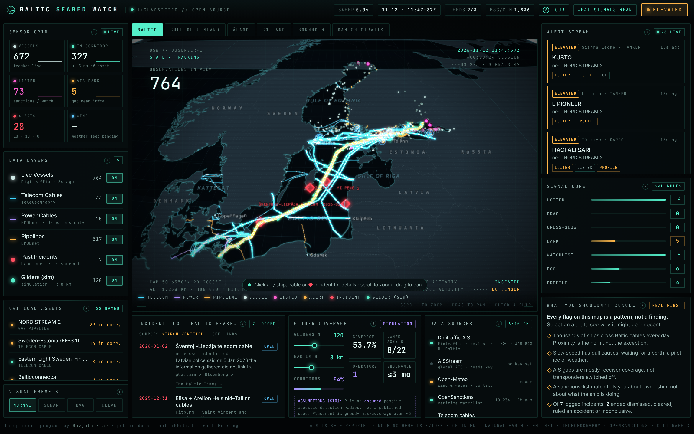

# Baltic Seabed Watch

A live map of the Baltic Sea: every ship moving right now, and the cables and pipelines on the seabed beneath them.
When a ship loiters, slows sharply or goes silent right over a cable, it gets flagged, and next to every flag the
site explains why it's probably innocent. The last layer shows how a few hundred autonomous underwater gliders could
listen below the surface and cover the gaps that ship tracking misses.



*Independent project by Ravjoth Brar. Public data only. Not affiliated with Helsing.*

## What's in it
| Layer | Source | Notes |
|---|---|---|
| Live ships | [Fintraffic Digitraffic](https://www.digitraffic.fi/en/marine-traffic/) (keyless), optional [aisstream.io](https://aisstream.io) | Digitraffic covers the northern Baltic; aisstream extends to the whole sea |
| Telecom cables | [TeleGeography](https://www.submarinecablemap.com) | 44 Baltic systems |
| Pipelines, power cables, ports | [EMODnet Human Activities](https://emodnet.ec.europa.eu/human-activities) | Power cables: German waters only (Estlink/NordBalt not in open data) |
| Sanctions & shadow fleet | [OpenSanctions maritime](https://www.opensanctions.org) | CC BY-NC, non-commercial use |
| Wind & waves | [Open-Meteo](https://open-meteo.com) | Used to *explain away* alerts |
| Incidents | `web/public/data/incidents.json` | 7 cases 2022–2026, each with sources |

## Signals
Seven plain rules in `server/detect.js`: `LOITER`, `DRAG`, `CROSS_SLOW`, `DARK`, `WATCHLIST`, `FOC`, `PROFILE`.
Each one carries its evidence and the innocent explanations it can't rule out (weather, port zones, ship type,
"waiting for orders", receiver coverage). Identity signals, such as a sanctions listing or a flag, never raise an
alert above WATCH without unusual behaviour as well.

## Run locally
```bash
npm install
```
```bash
npm run build
```
```bash
npm start
```
Open http://localhost:8787. For frontend dev with hot reload, run `npm start` in one terminal and `npm --prefix web run dev` in another, then open :5173. Add `?nohero` to skip the intro and `?tour` to force the tour.

Other commands: `npm run eval` runs the detection tests, `npm run fetch:static` rebuilds the cable layers, and `npm run fetch:watchlist` refreshes the sanctions list.

## Deploy
**Free: GitHub Pages (browser mode).** `.github/workflows/pages.yml` builds the site and deploys it to Pages on every
push to `main`, and again every 15 minutes. Visitors' browsers poll Digitraffic directly (it allows cross-origin requests and
needs no key) and run the same `server/engine.js` + `detect.js` locally. Each scheduled run samples about 10 minutes of AIS
and extends `data/history.json`, so tracks and loiter or slowdown rules work as soon as the page opens.
One-time setup: Settings → Pages → Source: **GitHub Actions**.

**Optional: Fly.io (server mode, about $3–5 a month).** One always-on Node process. It adds a 48 h SQLite archive (for
`npm run eval` on real labels), 10-second track resolution and whole-Baltic coverage via an aisstream.io key.
Run the `deploy-fly` workflow manually (needs `FLY_API_TOKEN`).

The front end detects which mode it's in (`web/src/datasource.js`): if `/api/snapshot` answers, it uses the server.
Otherwise it runs the engine in the browser.

## Layout
```
server/   engine.js (live picture, shared with browser) · detect.js (rules) · index.js (Node: SSE, SQLite, aisstream)
web/      Vite + CesiumJS front end (main.js, globe.js, basemap.js, tour.js, datasource.js, glider.worker.js)
scripts/  data builders     eval/  detection harness     docs/  contract, outreach, screenshots
```
