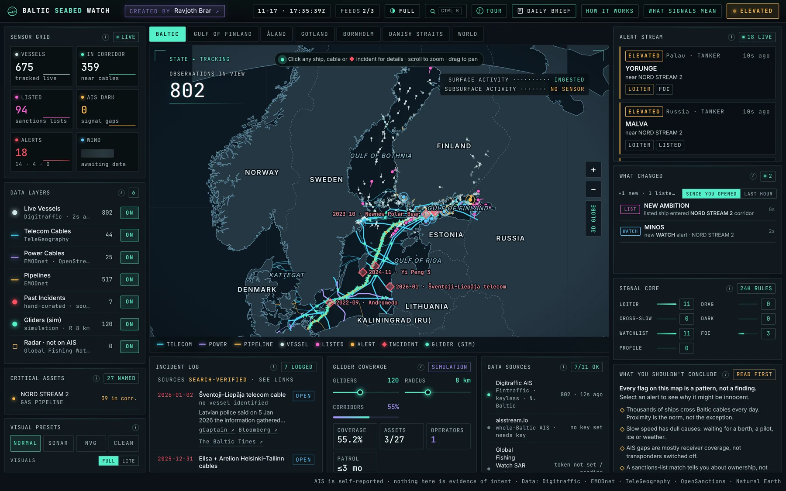
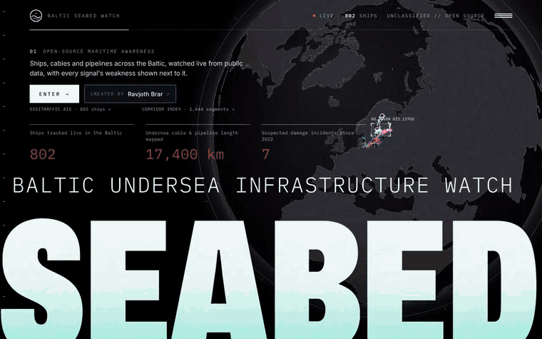
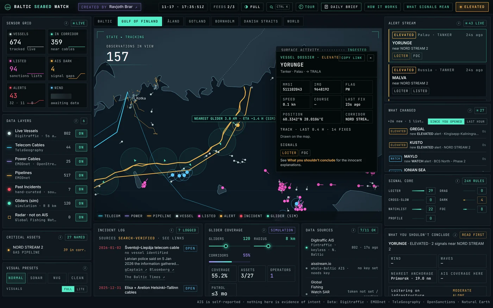
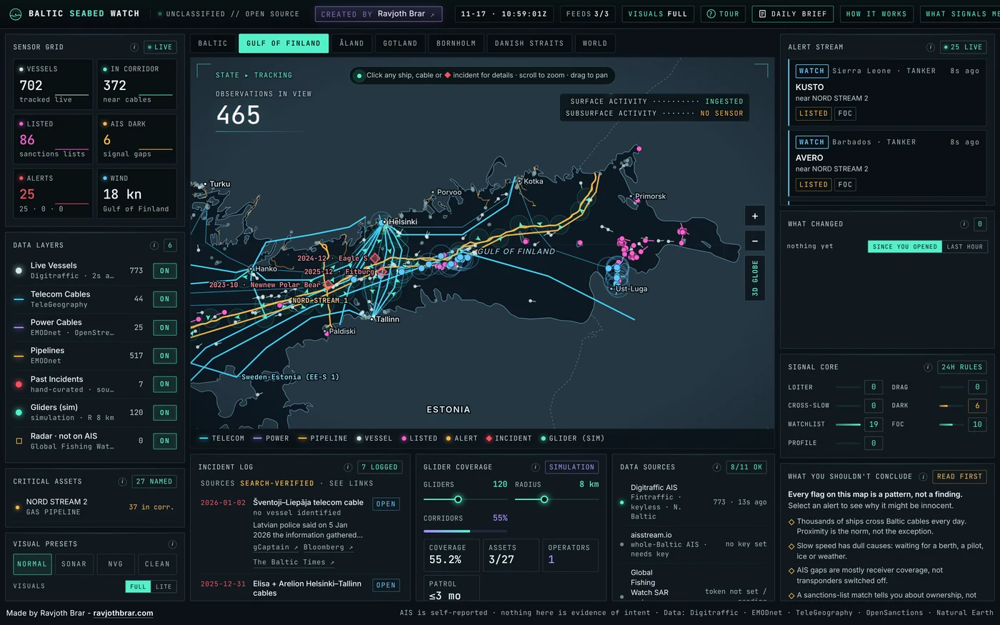
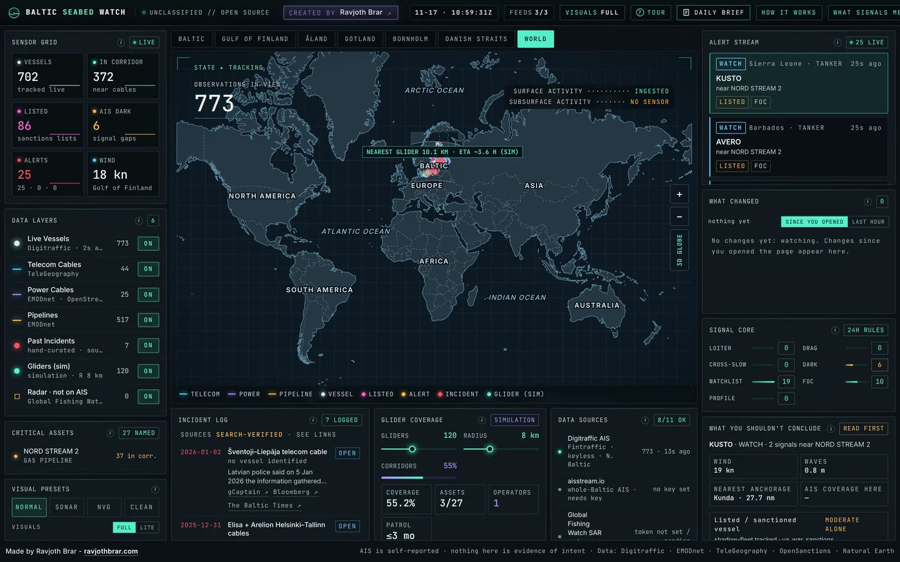
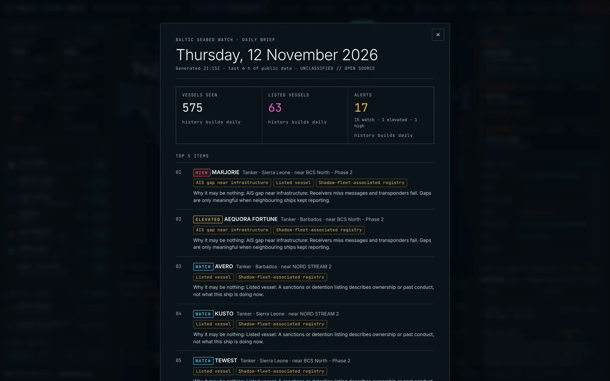
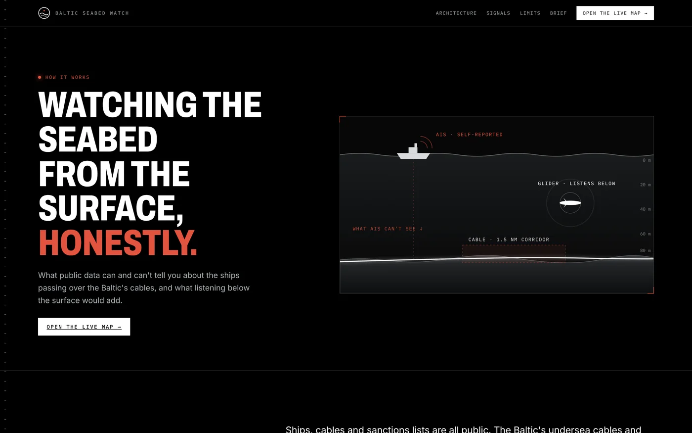
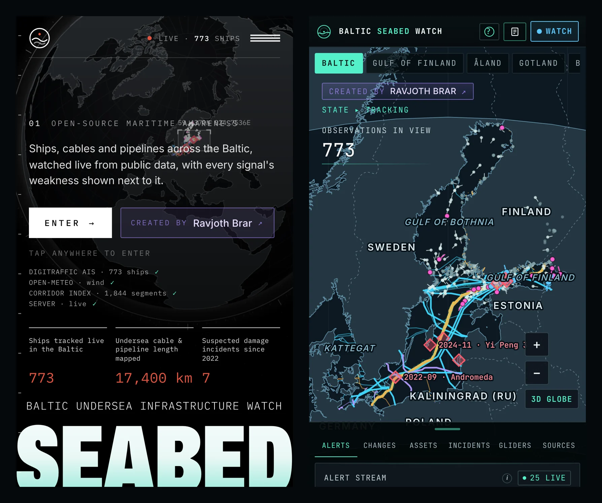
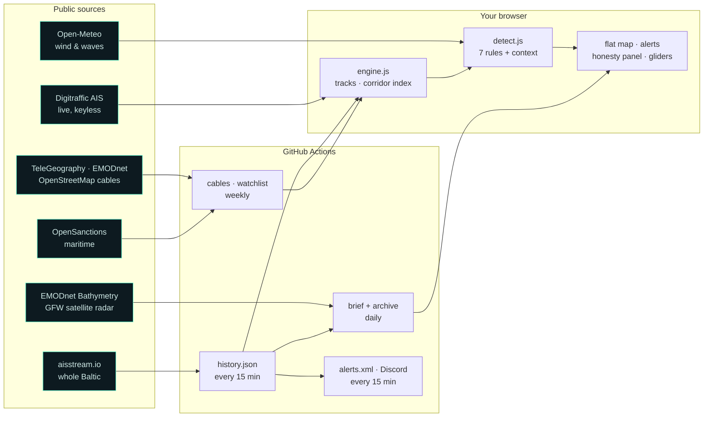

# Baltic Seabed Watch

**A live watch over the Baltic's undersea cables and pipelines. 10 public sources. 7 explainable rules. Zero keys to start.**

## Open the live map: [ravjothbrar.com/baltic-seabed](https://ravjothbrar.com/baltic-seabed/)

[](https://ravjothbrar.com/baltic-seabed/)
[](https://ravjothbrar.com/baltic-seabed/?nohero)
[](https://ravjothbrar.com/baltic-seabed/data/alerts.xml)

[](https://github.com/ravjothbrar/baltic-seabed/actions/workflows/ci.yml)
[](https://github.com/ravjothbrar/baltic-seabed/actions/workflows/pages.yml)
[](#quick-start)
[-orange)](#architecture)
[](#data-sources-10)
[](#api-keys)

<p align="center">
  <a href="docs/readme/dashboard.webp"></a>
</p>

**More screenshots**

<table>
  <tr>
    <th>Intro</th>
    <th>Every alert explains itself</th>
  </tr>
  <tr>
    <td width="50%"></td>
    <td width="50%"></td>
  </tr>
  <tr>
    <th>Gulf of Finland</th>
    <th>Whole world</th>
  </tr>
  <tr>
    <td></td>
    <td></td>
  </tr>
  <tr>
    <th>Daily brief</th>
    <th>How it works</th>
  </tr>
  <tr>
    <td></td>
    <td></td>
  </tr>
</table>

<p align="center"></p>

> [!IMPORTANT]
> **Every flag is a pattern, not a finding.** AIS is self-reported, can be switched off, and sees nothing below the
> waterline. Next to every alert sits a **"What you shouldn't conclude"** panel listing the ordinary reasons the same
> pattern appears. Nothing on this site is evidence of intent.

Since 2022, ships have been accused of damaging Baltic undersea cables and pipelines again and again: Balticconnector,
Estlink 2, C-Lion1 and more. Baltic Seabed Watch shows the whole picture live. It covers every ship moving right now, the
cables, power links and pipelines beneath them, vessels on sanctions and shadow-fleet lists, and a sourced log of every
past incident with **how each case actually ended**.

---

## Why This Exists

Surface data alone has never settled one of these cases. Eagle S was found with seabed drag marks, yet a district court
dismissed the case. Yi Peng 3 ended inconclusive. Vezhen was ruled an accident.

So the last layer asks the obvious next question: **what would persistent underwater sensing add?** A simulation places
a few hundred autonomous gliders along the cable corridors, weighted by cable length, live traffic and real seabed depth.
It shows how much of the network one operator could keep under watch. It is labelled **SIMULATION**, with every
assumption on screen.

---

## Quick Start

```bash
# 1. Clone the repo
git clone https://github.com/ravjothbrar/baltic-seabed.git && cd baltic-seabed

# 2. Install dependencies (server: just express + ws)
npm install && npm --prefix web install

# 3. Check everything (Node, data files, every source, every key)
npm run diag

# 4. Build the front end and start
npm run build && npm start
```

**Requirements:** Node 22+ (native `fetch`, built-in `node:sqlite`, top-level `await`, ESM).

Open http://localhost:8787. The first ships appear within a few seconds. The alert stream fills as tracks build up,
because rules like LOITER need 20+ minutes of history. Add `?nohero` to skip the intro, or `?tour` to replay the guided tour.

> **No server at all?** The hosted site runs the same engine entirely in your browser on free GitHub Pages.
> GitHub Actions rebuilds the data every 15 minutes.

---

## What You Get

### Live map
- **Mercator map, anchorage to planet.** Wheel, pinch or drag. Labels stay readable at every zoom level, with presets for Baltic, Gulf of Finland, Åland, Gotland, Bornholm, Danish Straits and World.
- **About 750 live ships** over 580+ telecom, power and pipeline lines, with listed vessels in magenta.
- **Smooth movement.** Ships glide between position fixes, capped at 2 minutes of dead reckoning. Moored ships never drift.
- **3D globe mode** for the cinematic view, loaded only when you ask for it.
- **Visual presets:** NORMAL, SONAR, NVG and CLEAN.

### Alerts that explain themselves
- **Seven plain rules** (see [How it flags](#how-it-flags)). Each records its evidence and the innocent explanations it can't rule out.
- **Vessel dossier:** track, flag, type, sanctions entries, and every signal with its evidence.
- **What changed:** a running log of new, escalated and cleared alerts, listed ships entering a named corridor, and feeds dropping or recovering. Choose "since you opened" or the last hour.

### Find and share
- **Search (⌘K / Ctrl+K or `/`):** ships by name, MMSI or IMO, named cables and pipelines, incidents and places.
- **Links to one thing:** `?alert=<mmsi>`, `?ship=<mmsi>`, `?asset=<name>` and `?brief=<date>` open straight onto it. Every alert and dossier has a **Copy link** button.
- **Daily brief and archive:** a one-page summary each morning with a 14-day trend. Past days stay browsable at their own links.

### Alerts outside the site
- **RSS:** [`data/alerts.xml`](https://ravjothbrar.com/baltic-seabed/data/alerts.xml) and JSON, refreshed every 15 minutes. It works in any reader, Slack or IFTTT.
- **Discord (optional):** FLASH and PRIORITY alerts are pushed with their evidence and "why it may be nothing". There's a cooldown per ship and an hourly cap per tier, so a busy night can't flood the channel.

| Tier | Level | Pushed | Cooldown per ship | Max per hour |
|---|---|---|---|---|
| FLASH | HIGH | yes | 60 min | 6 |
| PRIORITY | ELEVATED | yes | 180 min | 4 |
| ROUTINE | WATCH | RSS only | n/a | n/a |

### Performance Modes
**Visuals Lite** turns off glow, grain, scanlines, pulses and animation. When it's on, the map:
- redraws only when something changes (0 animation frames while idle);
- snaps ships to their fixes instead of gliding them;
- skips the intro swoop and fades straight to the map.

It's on by default on phones and with reduced motion. Switch it with **L**, the top-bar chip, or under Visual Presets.

### Real boot check
The landing screen and the map show each feed's **actual** status as it arrives, such as `Digitraffic · 773 ships` or
`aisstream · no key`. Failures show in amber. Nothing gets a ✓ it hasn't earned.

### Keyboard

| Key | What it does |
|---|---|
| `1`–`7` | Map presets, Baltic to World |
| `/` or `⌘K` | Search |
| `L` | Visuals Lite on/off |
| `G` | 3D globe on/off |
| `B` | Daily brief |
| `?` | Shortcut cheat sheet |
| `Esc` | Close the top overlay |

---

## How it flags

Seven plain, explainable rules. No black box.

| Signal | Fires when | Why it's weak on its own |
|---|---|---|
| `LOITER` | 20+ min at < 3 kn inside a cable corridor, away from port | Ships wait for berths, pilots, orders and weather |
| `DRAG` | ≥ 2 km and ≥ 10 min of consecutive slow, "under way" fixes along a corridor, well below the ship's usual speed | Engine trouble, ice and traffic schemes look the same |
| `CROSS_SLOW` | Crosses a named asset at half its usual speed | Common in busy lanes |
| `DARK` | AIS silent ≥ 45 min near infrastructure **while 5+ nearby ships kept reporting** | Receivers miss messages; transponders fail |
| `WATCHLIST` | IMO or MMSI on a sanctions or shadow-fleet list | Describes ownership, not what the ship is doing now |
| `FOC` | Flag registry often used by the shadow fleet | Thousands of legitimate ships fly these flags |
| `PROFILE` | A tanker or bulk carrier *leaving* a Russian Gulf of Finland port, plus slow movement | Most such ships are simply trading |

Identity signals (`WATCHLIST`, `FOC`, `PROFILE`) **never** raise an alert above WATCH on their own. Escalation needs
unexplained behaviour. Context checks lower the level in four cases:
- gale-force wind;
- fishing boats, tugs and pilot vessels;
- port zones;
- destinations reading "for orders".

---

## API Keys

### Without Any Keys
It runs out of the box on Digitraffic's open, live AIS (northern Baltic), plus the cable, pipeline, sanctions and
incident data committed to this repo. Everything below is optional.

### Optional (all free)
Set these in a local `.env` (see [`.env.example`](.env.example)) or as **GitHub Actions secrets** for the hosted site.
None of them ever reaches the browser.

| Key | Unlocks | How to get it |
|---|---|---|
| `AISSTREAM_API_KEY` | Whole-Baltic ships, not just the north | [aisstream.io](https://aisstream.io) → sign in with GitHub → API Keys · instant |
| `GFW_API_TOKEN` | Satellite-radar detections of ships not on AIS | [globalfishingwatch.org](https://globalfishingwatch.org/our-apis/) → request access (non-commercial) · 1–2 days |
| `DISCORD_WEBHOOK_URL` | FLASH / PRIORITY pushes to a Discord channel | Channel → Edit → Integrations → Webhooks → New · instant |

---

## Architecture

```
baltic-seabed/
├── config/
│   └── seabed.config.js     # every threshold and alert tier, shared by browser and server
├── server/
│   ├── engine.js            # the live picture: tracks, corridor index, sweeps (runs in browser AND Node)
│   ├── detect.js            # the 7 rules + context checks
│   ├── corridors.js         # 1.5 nm corridors around every cable and pipeline
│   └── index.js             # optional Node server: SSE stream, SQLite archive, /api/health
├── web/                     # Vite + vanilla JS front end
│   ├── src/flatmap.js       # d3 Mercator map (canvas ships, SVG geography)
│   ├── src/heroglobe.js     # the intro globe
│   ├── src/globe.js         # 3D mode (CesiumJS, keyless imagery, loaded on demand)
│   └── how.html             # the How it works page
├── scripts/
│   ├── fetch-static.mjs     # cables, pipelines, ports, bathymetry → web/public/data
│   ├── fetch-watchlist.mjs  # OpenSanctions maritime → server/data/watchlist.json
│   ├── build-history.mjs    # 6 h AIS snapshot for the static site (every 15 min)
│   ├── build-brief.mjs      # daily brief            archive-brief.mjs  # dated archive
│   ├── build-alerts.mjs     # RSS + JSON + Discord   replay.mjs         # shared replay
│   └── diag.mjs             # npm run diag
├── eval/                    # synthetic cases + regression checks
└── .github/workflows/       # pages (every 15 min) · refresh-data (weekly) · ci
```



### Design Principles
- **One engine, two homes.** The same `engine.js` and `detect.js` run in the browser on free GitHub Pages, or in a small Node server.
- **No keys in the browser.** Visitors only fetch static files and Digitraffic's open API.
- **Minimal dependencies.** The server uses Express and ws; the front end is vanilla JS and d3.
- **Graceful degradation.** Any source can fail, and the page says so instead of guessing.
- **Each source stands alone.** Every `fetch:*` and `build-*` script runs and is tested on its own.
- **Honest by construction.** No bare scores. Every alert ships with its evidence and its innocent explanations.
- **Fast.** The intro paints in about 0.25 s. The 3D library loads only on request.

---

## Data Sources (10)

### Ships
| Source | What it gives | Auth |
|---|---|---|
| **[Fintraffic Digitraffic](https://www.digitraffic.fi/en/marine-traffic/)** | Live AIS, northern Baltic, about 10 s updates (CC BY 4.0) | None |
| **[aisstream.io](https://aisstream.io)** | Whole-Baltic AIS, sampled every 15 min in Actions | Free key |
| **[Global Fishing Watch](https://globalfishingwatch.org)** | Satellite-radar ship detections, about 5-day lag (CC BY-NC 4.0) | Free token |

### Seabed infrastructure
| Source | What it gives | Auth |
|---|---|---|
| **[TeleGeography](https://www.submarinecablemap.com)** | 44 Baltic telecom cable systems | None |
| **[EMODnet Human Activities](https://emodnet.ec.europa.eu/human-activities)** | Pipelines, power cables, ports | None |
| **[OpenStreetMap](https://www.openstreetmap.org)** via Overpass | HVDC links such as NordBalt and SwePol (ODbL) | None |
| **[EMODnet Bathymetry](https://emodnet.ec.europa.eu/en/bathymetry)** | Seabed depth for the glider depth mask | None |

### Context
| Source | What it gives | Auth |
|---|---|---|
| **[OpenSanctions](https://www.opensanctions.org)** | Maritime sanctions and shadow-fleet lists (CC BY-NC 4.0) | None |
| **[Open-Meteo](https://open-meteo.com)** | Wind and waves, used to *explain away* alerts | None |
| **[Natural Earth](https://www.naturalearthdata.com)** | Land and coastlines | None |

Plus a **hand-curated incident log**, [`incidents.json`](web/public/data/incidents.json), where every field has a source link.

---

## npm Scripts

| Script | What it does |
|---|---|
| `npm run diag` | Checks Node, dependencies, data files, every source and every key, and says how to fix what's missing |
| `npm run build` | Builds the front end into `web/dist` |
| `npm start` | Server + API + SSE stream + built site on :8787 |
| `npm run dev` | Server and Vite dev server together |
| `npm run eval` | Replays synthetic cases and regression checks through the rules |
| `npm run fetch:static` | Rebuilds cables, pipelines, ports and bathymetry |
| `npm run fetch:watchlist` | Rebuilds the sanctions watchlist |

## Configuration

Every rule threshold lives in [`config/seabed.config.js`](config/seabed.config.js), shared by browser and server. Change a value and run `npm run eval`.

| Variable | Default | Description |
|---|---|---|
| `PORT` | `8787` | Server port |
| `DATA_DIR` | `./data` | Where the SQLite archive lives |
| `AISSTREAM_API_KEY` | — | Whole-Baltic AIS |
| `GFW_API_TOKEN` | — | Satellite radar |
| `DISCORD_WEBHOOK_URL` | — | Alert pushes |

## API Endpoints

Only available with the Node server; the static site uses files under `data/`.

| Endpoint | Description |
|---|---|
| `GET /api/snapshot` | Every ship, alert and feed status right now |
| `GET /api/stream` | Server-sent events: live updates |
| `GET /api/vessel/:mmsi` | One ship's dossier and track |
| `GET /api/alerts/log` | The last 200 alerts |
| `GET /api/health` | Uptime, counts and per-feed status |

---

## Troubleshooting

### The alert stream is empty right after starting
This is normal. Rules like LOITER and DRAG need 10–20+ minutes of track history. The Node server restores the last 6 h
from SQLite on restart, so this only happens on the very first run.

### Only ships in the northern Baltic show up
That's Digitraffic's coverage. Add `AISSTREAM_API_KEY` for the whole sea.

### "Named HVDC links: missing estlink" in `npm run diag`
Overpass often refuses connections from cloud machines. Run the **refresh-data** workflow in GitHub Actions, which fetches it reliably.

### Weather shows "no reading"
Open-Meteo rate-limits shared IPs. The page retries hourly and simply doesn't use weather to lower alerts until then.

---

## What it can't see

- **Nothing below the surface.** That's the point of the glider layer.
- **Coverage is uneven.** Northern Baltic ships update every 10 s; the rest of the sea updates every 15 min.
- **AIS can lie.** Positions can be spoofed, and transponders can be switched off.
- **Not evidence.** The false-positive rate on real traffic is still being measured. The synthetic and regression tests prove only that the rules do what they say.

---

<p align="center">
  Made by <a href="https://ravjothbrar.com"><b>Ravjoth Brar</b></a> · independent project · public data only · not affiliated with or endorsed by Helsing or any data provider
</p>
