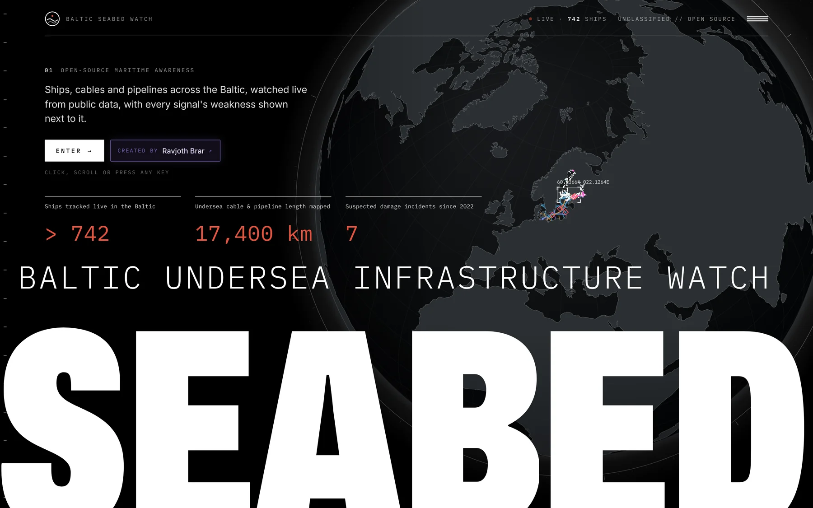
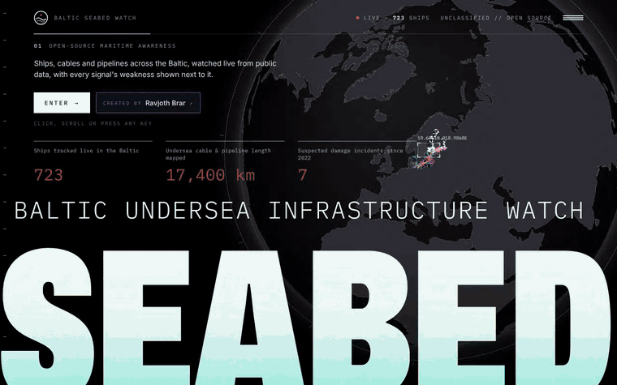
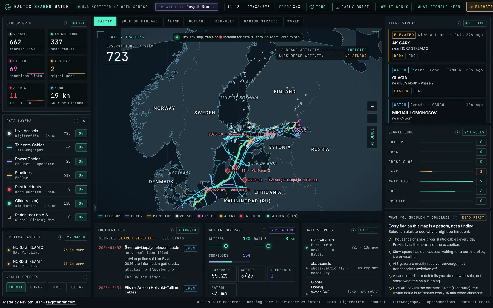
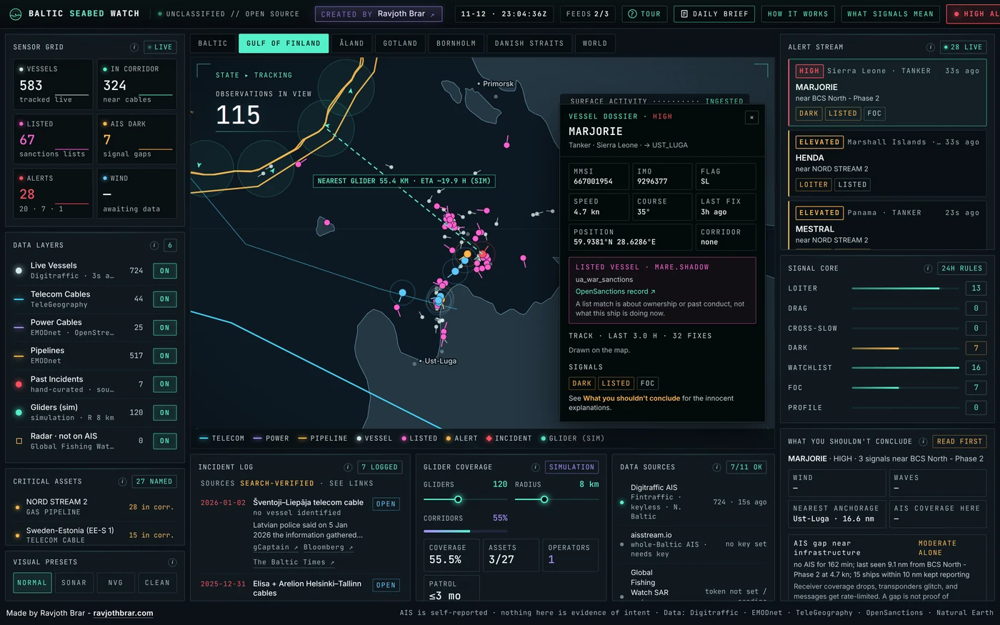
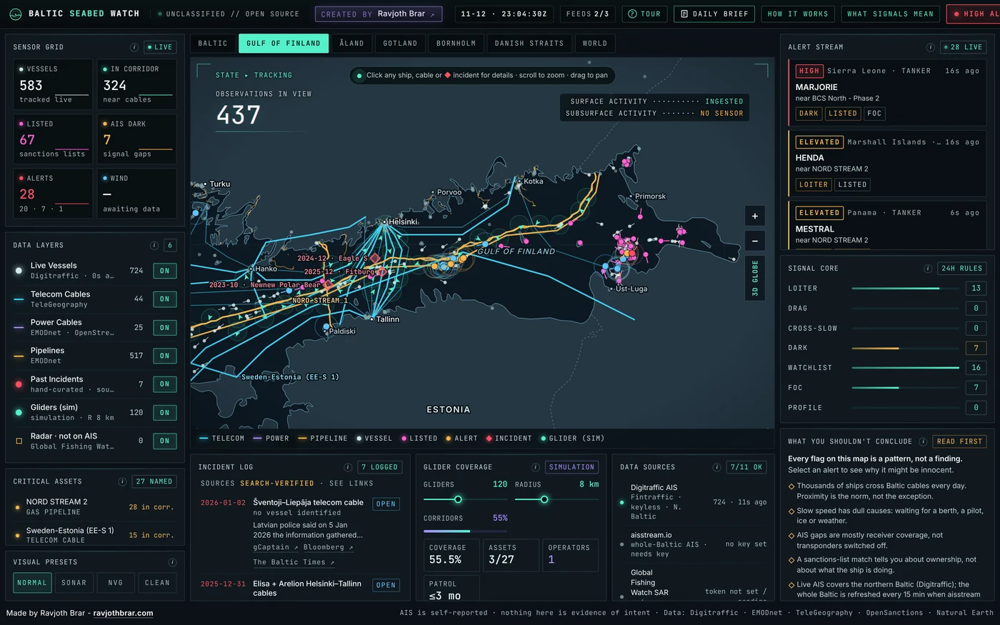
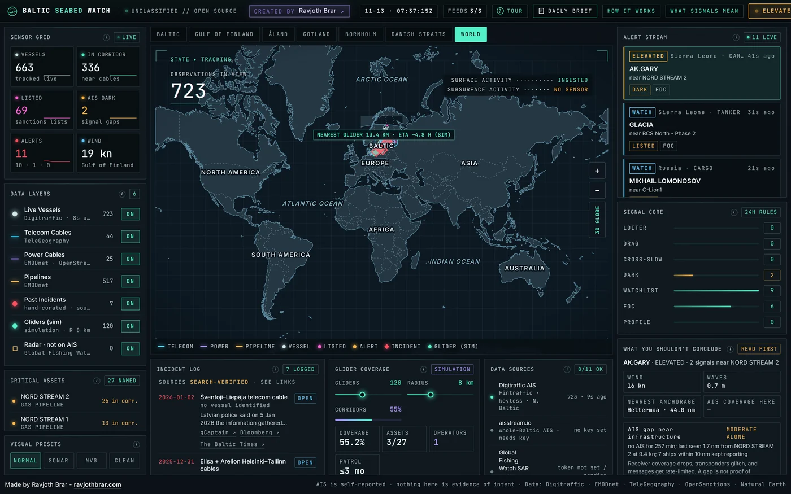
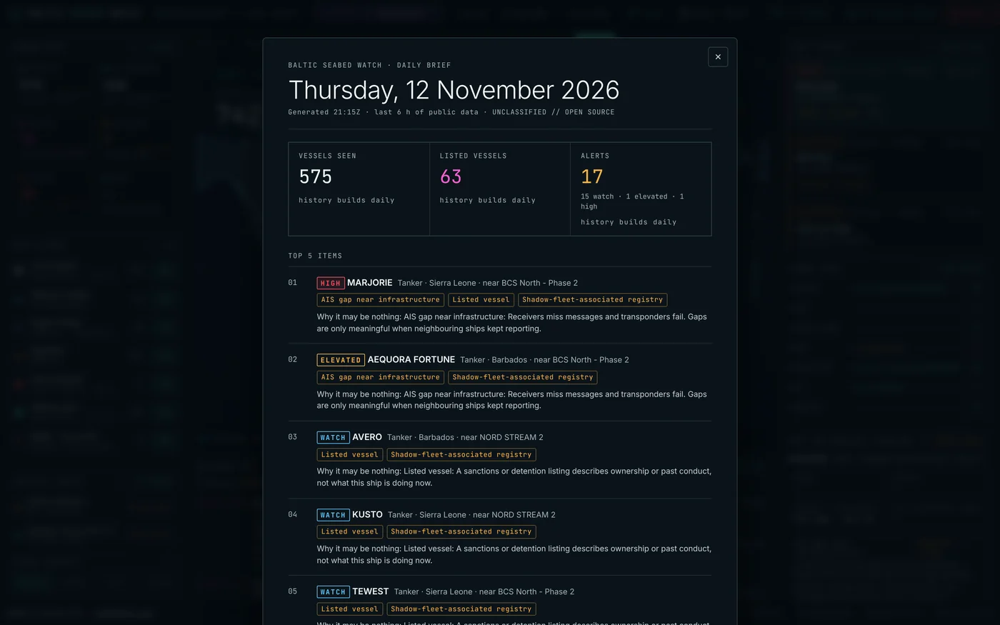
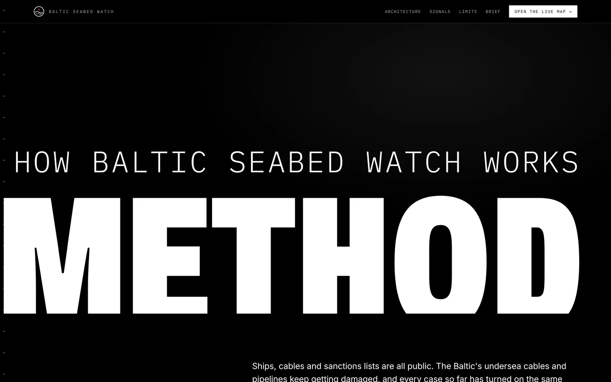
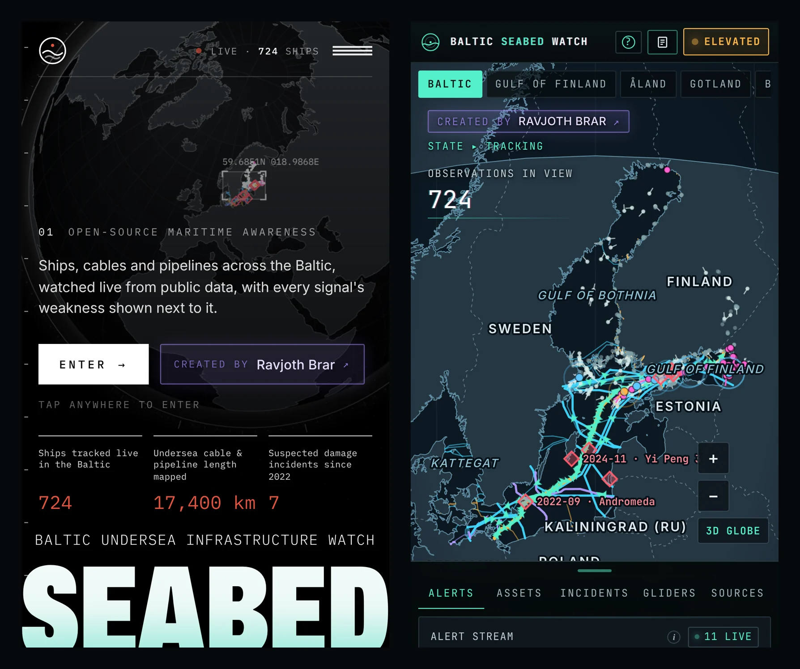
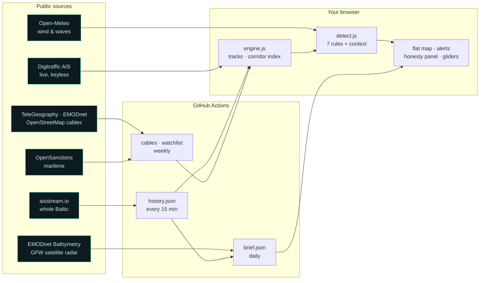

<p align="center">
  
</p>

# Baltic Seabed Watch

**A live watch over the Baltic's undersea cables and pipelines, built only from public data, that tells you how weak every signal is.**

[](https://github.com/ravjothbrar/baltic-seabed/actions/workflows/ci.yml)
[](https://github.com/ravjothbrar/baltic-seabed/actions/workflows/pages.yml)


### → [Open the live map: ravjothbrar.com/baltic-seabed](https://ravjothbrar.com/baltic-seabed/)

*Works on laptop, desktop and phone. Press any key on the intro to skip straight to the map.*

<p align="center">
  
</p>

---

## What is this?

Since 2022, ships have been accused of damaging Baltic undersea cables and pipelines again and again: Balticconnector,
Estlink 2, C-Lion1 and more. Baltic Seabed Watch shows the whole picture live:

- every ship moving right now;
- the telecom cables, power links and gas pipelines on the seabed beneath them;
- vessels on sanctions and shadow-fleet lists;
- a sourced log of every past incident and **how each case actually ended**.

When a ship loiters, slows sharply or goes silent over a cable, it gets flagged. Next to every flag sits a panel called
**"What you shouldn't conclude"**, listing the ordinary reasons the same pattern appears: weather, a ship waiting for
orders, a port nearby, receiver coverage, the ship's type.

## Why?

Because surface data alone has never settled one of these cases. Eagle S was found with seabed drag marks, yet a district
court dismissed the case. Yi Peng 3 ended inconclusive, and Vezhen was ruled an accident. AIS, the system ships use to
broadcast their position, is self-reported, can be switched off, and sees nothing below the waterline.

So the last layer asks the obvious next question: **what would persistent underwater sensing add?** A simulation places
a few hundred autonomous gliders along the cable corridors, weighted by cable length, live traffic and real seabed depth,
and shows how much of the network one operator could keep under watch.

## A tour of the interface

<table>
  <tr>
    <td width="50%"></td>
    <td width="50%"></td>
  </tr>
  <tr>
    <td><b>The live picture.</b> About 750 ships, 580+ cable and pipeline lines, sanctions matches and a calm, Crucix-style dashboard. Wheel or pinch to zoom, from the whole world down to a single anchorage.</td>
    <td><b>Every alert explains itself.</b> Open one to see the ship's dossier, its track, each signal's evidence, and why it may be nothing.</td>
  </tr>
  <tr>
    <td></td>
    <td></td>
  </tr>
  <tr>
    <td><b>Gulf of Finland.</b> Where Estlink 2, Balticconnector and most of the incidents sit, and where listed tankers wait for orders.</td>
    <td><b>From anchorage to planet.</b> A Mercator map with readable labels at every zoom level, plus a 3D globe mode.</td>
  </tr>
  <tr>
    <td></td>
    <td></td>
  </tr>
  <tr>
    <td><b>Daily brief.</b> A one-page summary generated every morning by the same engine, with a 14-day trend.</td>
    <td><b>How it works.</b> Architecture, every rule and threshold, the tests, and the limits, written in plain English.</td>
  </tr>
</table>

<p align="center"></p>

## How it decides what to flag

Seven plain, explainable rules (no black box). Every rule records its evidence **and** the innocent explanations it can't rule out.

| Signal | Fires when | Why it's weak on its own |
|---|---|---|
| `LOITER` | 20+ min at < 3 kn inside a cable corridor, away from port | Ships wait for berths, pilots, orders and weather |
| `DRAG` | ≥ 2 km and ≥ 10 min of consecutive slow, "under way" fixes along a corridor, well below the ship's usual speed | Engine trouble, ice and traffic schemes look the same |
| `CROSS_SLOW` | Crosses a named asset at half its usual speed | Common in busy lanes |
| `DARK` | AIS silent ≥ 45 min near infrastructure **while 5+ nearby ships kept reporting** | Receivers miss messages; transponders fail |
| `WATCHLIST` | IMO or MMSI on a sanctions or shadow-fleet list | Describes ownership, not what the ship is doing now |
| `FOC` | Flag registry often used by the shadow fleet | Thousands of legitimate ships fly these flags |
| `PROFILE` | A tanker or bulk carrier *leaving* a Russian Gulf of Finland port, plus slow movement | Most such ships are simply trading |

Identity signals (`WATCHLIST`, `FOC`, `PROFILE`) **never** raise an alert above WATCH on their own. Escalation needs unexplained behaviour.
Context checks drop the alert level when the wind is at gale force, when the ship is a fishing boat, tug or pilot vessel,
when it's in a port zone, or when its destination reads "for orders".

## Architecture



- **One engine, two homes.** `server/engine.js` and `detect.js` run unchanged in the browser (on free GitHub Pages) or in a small Node server (optional, for a 48 h archive).
- **No keys in the browser.** The aisstream key lives only in a GitHub Actions secret; visitors only ever fetch static files and Digitraffic's open API.
- **Fast.** The intro paints in about 0.25 s and draws the globe's land in about 0.5 s. The heavy 3D library loads only if you ask for 3D mode.

## Data sources

| Layer | Source | Licence / notes |
|---|---|---|
| Live ships | [Fintraffic Digitraffic](https://www.digitraffic.fi/en/marine-traffic/) | CC BY 4.0 · northern Baltic, live |
| Whole-Baltic ships | [aisstream.io](https://aisstream.io) | via 15-min snapshots in Actions |
| Telecom cables | [TeleGeography Submarine Cable Map](https://www.submarinecablemap.com) | 44 Baltic systems |
| Pipelines, power cables, ports | [EMODnet Human Activities](https://emodnet.ec.europa.eu/human-activities) | |
| HVDC links (NordBalt, SwePol, …) | [OpenStreetMap](https://www.openstreetmap.org) via Overpass | ODbL · Estlink still missing from reachable data |
| Seabed depth | [EMODnet Bathymetry](https://emodnet.ec.europa.eu/en/bathymetry) | glider depth mask |
| Sanctions & shadow fleet | [OpenSanctions](https://www.opensanctions.org) maritime export | CC BY-NC 4.0 (non-commercial) |
| Weather | [Open-Meteo](https://open-meteo.com) | used to *explain away* alerts |
| Satellite radar | [Global Fishing Watch](https://globalfishingwatch.org) SAR detections | CC BY-NC 4.0 · ~5-day lag |
| Incidents | hand-curated, every field sourced | [`incidents.json`](web/public/data/incidents.json) |

## What it can't see

- **Nothing below the surface.** That's the point of the glider layer, which is labelled **SIMULATION** with every assumption on screen.
- **Coverage is uneven.** Northern Baltic ships update every 10 s; the rest of the sea refreshes every 15 min.
- **AIS can lie.** Positions can be spoofed, and transponders can be switched off.
- **Not evidence.** The false-positive rate on real traffic is still being measured from hand-labelled episodes. The synthetic and regression tests pass, but they only prove the rules do what they say.

## Run it yourself

```bash
npm install && npm --prefix web install
```

```bash
npm run build && npm start
```

Open http://localhost:8787. Add `?nohero` to skip the intro, or `?tour` to replay the guided tour.

```bash
npm run eval
```

That runs the detection test cases and the regression checks. Deployment (free GitHub Pages, or optional Fly.io) is covered in [`.github/workflows`](.github/workflows).

<details>
<summary><b>Repository layout</b></summary>

```
server/   engine.js (live picture, shared with the browser) · detect.js (rules) · corridors.js · index.js (optional Node server)
web/      Vite front end: flatmap.js (d3 map) · heroglobe.js (intro) · globe.js (3D mode) · tour.js · brief.js · how.html
scripts/  data builders: cables, watchlist, history, brief, satellite radar, bathymetry
eval/     synthetic cases + regression tests for the rules
docs/     data contract, screenshots
```
</details>

---

<p align="center">
  Made by <a href="https://ravjothbrar.com"><b>Ravjoth Brar</b></a> · independent project · public data only · not affiliated with or endorsed by Helsing or any data provider
</p>
